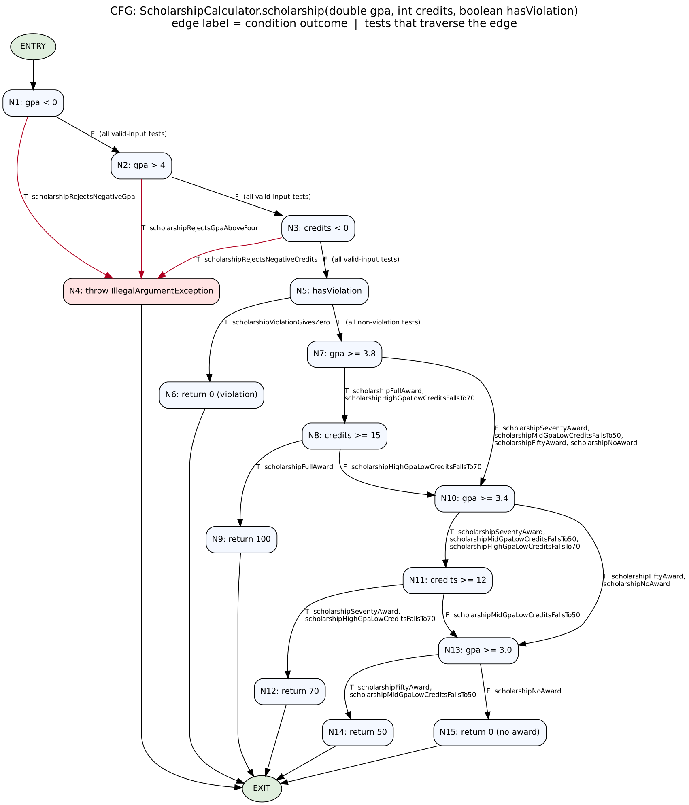

# Lab 09 — Код хамралт: JaCoCo-гоор тестээ хөтлөх


- **Нэр:** Nyamod Nyamsuren
- **Оюутны код:** B222270805
- **Хичээл:** F.CSA313 — Программ хангамжийн чанарын баталгаа ба тест (2026)
- **Бай:** `ScholarshipCalculator` (`letterGrade`, `gpa`, `scholarship`)

## Орчин

`java -version`:

```
java version "23.0.2" 2025-01-21
Java(TM) SE Runtime Environment (build 23.0.2+7-58)
Java HotSpot(TM) 64-Bit Server VM (build 23.0.2+7-58, mixed mode, sharing)
```

`mvn -version`:

```
Apache Maven 3.9.12 (848fbb4bf2d427b72bdb2471c22fced7ebd9a7a1)
Maven home: /opt/homebrew/Cellar/maven/3.9.12/libexec
Java version: 25.0.2, vendor: Homebrew, runtime: /opt/homebrew/Cellar/openjdk/25.0.2/libexec/openjdk.jdk/Contents/Home
Default locale: en_MN, platform encoding: UTF-8
OS name: "mac os x", version: "26.5", arch: "aarch64", family: "mac"
```

## Репогийн бүтэц

```
pom.xml                      JUnit 5 + JaCoCo (report + check gate)
src/main/java/...            ScholarshipCalculator.java
src/test/java/...            ScholarshipCalculatorTest.java
cfg.png, cfg.dot             scholarship()-ийн CFG (cfg.dot -> Graphviz -> cfg.png)
results/                     mvn гаралт ба jacoco.csv (A, B, final), mvn-test-D-fail.txt, gate-demo-fail.txt
.github/workflows/ci.yml     GitHub Actions CI (Сонголт 1)
```

Тестүүдийг `mvn clean verify`-ээр ажиллуулсан (өмнөх `jacoco.exec` нэмэгдэж тайланг бохирдуулахгүйн тулд `clean`).

## Хэсэг A — Happy path ба эхний хэмжилт

5 тест (`letterGradeA`, `letterGradeB`, `gpaTwoGrades`, `scholarshipFullAward`, `scholarshipSeventyAward`), зөвхөн хэвийн урсгал.
Гаралт: `results/mvn-verify-A.txt` (Tests run: 5), хамралт: `results/jacoco-A.csv`.

| | Instruction (missed / covered) | Branch (missed / covered) | Line (missed / covered) |
|---|---|---|---|
| A | 50 / 102 (67.1%) | 21 / 20 (48.8%) | 10 / 15 (60.0%) |

Branch = 20/41 = **49%**, Line = 15/25 = **60%**.

**Ажиглалт.** Шар (хагас хамрагдсан) мөрүүд: функц бүрийн эхний оролтын шалгалт (`if (score < 0 || score > 100)`, `if (scores == null || ...)`, `if (gpa < 0 || ...)`) — зөвхөн «зөв оролт» талыг л туршсан тул `||` нөхцөл бүрийн ҮНЭН тал дутуу. Мөн `switch` мөр, `if (score >= 80)`, `if (hasViolation)`, `if (gpa >= 3.8 && credits >= 15)`, `if (gpa >= 3.4 && credits >= 12)` шар — нэг тал нь л дайрагдсан.
Улаан (огт хүрээгүй) мөрүүд нь алдааны замууд: гурван функцийн бүх `throw`, мөн `letterGrade`-ийн "C" / "D" / "F" буцаах мөр, `gpa`-гийн `switch` дахь C, D, default тал, `scholarship`-ийн `if (gpa >= 3.0)` ба эцсийн `return 0`.

## Хэсэг B — CFG ба branch 100%

`scholarship()`-ийн CFG: 

Зангилаа N1..N15 нь нөхцөл бүр (JaCoCo `&&` / `||` бүрийн нөхцөлийг тусдаа салаа гэж тоолдог тул нөхцөл бүр тусдаа зангилаа), ирмэг бүр дээр T/F ба тэр ирмэгийг дайрах тестийн нэр бичигдсэн (нэрс нь `ScholarshipCalculatorTest`-ийн бодит метод нэртэй яг таарна). `cfg.png`-г Graphviz-ээр (`cfg.dot`) зурсан.

**Нийт 21 тест шаардагдсан** (`results/mvn-verify-B.txt`: `Tests run: 21, Failures: 0, Errors: 0`): `letterGrade` 7, `gpa` 4, `scholarship` 10.

| | Instruction (missed / covered) | Branch (missed / covered) | Line (missed / covered) |
|---|---|---|---|
| B | 0 / 152 (100.0%) | 0 / 41 (100.0%) | 0 / 25 (100.0%) |

`results/jacoco-B.csv`-д **BRANCH_MISSED = 0**, **LINE_MISSED = 0**.

## Хэсэг C — Давталтын заагийн тестүүд

`gpa()` доторх давталтад 0 / 1 / 2+ дүрмийг хэрэглэсэн:

- 0 удаа: `gpaLoopZeroIterationsEmptyArray` (`new double[0]`) ба `gpaLoopZeroIterationsNull` (`null`) — хоёулаа `assertThrows(IllegalArgumentException.class, ...)`
- 1 удаа: `gpaLoopOneIteration` — `gpa([95]) == 4.0`
- 2+ удаа: `gpaLoopManyIterations` — `gpa([95, 85, 75, 65]) == 2.5`

Эдгээр нь хамралтын тоог өсгөхгүй (B дээр аль хэдийн 100%), гэхдээ хэрэгтэй хэвээр: хамралт нь давталтын мөр ажилласан эсэхийг л хэмждэг бол 0 / 1 / 2+ тест нь давталт ХЭДЭН удаа ажиллахаас хамаардаг алдааг (хоосон эсвэл `null` оролтыг хаяхгүй байх, нэг элементтэй үед дундаж буруу гарах, олон элементийн нийлбэр буруу хуримтлагдах) илрүүлдэг. Мөн гурван тохиолдол тус бүр өөр зам (шидэлт / нэг удаа / олон удаа) тул ирээдүйд давталтыг өөрчилбөл эхэлж эдгээр тест унана.

## Хэсэг D — Хамралт 100%, гэхдээ алдаа амьд

Спецификаци: 60–69.99 оноо = "D". Зааг утгын тест нэмсэн (`letterGradeBoundaries`: 0, 59.99, 60, 69.99, 70, 79.99, 80, 89.99, 90, 100; `gpaScoreSixtyCountsAsD`; `scholarshipThresholdBoundaries`).
`mvn test` дээр **2 тест унасан** (`results/mvn-test-D-fail.txt`, `Tests run: 45, Failures: 2`):

```
ScholarshipCalculatorTest.gpaScoreSixtyCountsAsD:168 expected: <1.0> but was: <0.0>
ScholarshipCalculatorTest.letterGradeBoundaries:162 expected: <D> but was: <F>
```

Алдаа: `letterGrade`-д `if (score > 60)` гэж бичсэн, харин спецификаци 60-г "D" гэнэ → `score >= 60` байх ёстой. Засвар тусдаа commit-оор: [`678ec60`](https://github.com/thenemoooo/Lab9-Code-Coverage-Tracking-Tests-with-JaCoCo/commit/678ec60) — «Fix letterGrade: > 60 -> >= 60, spec says 60 is D». Засварын дараа бүх 45 тест ногоон (`results/mvn-verify-final.txt`), хамралт `results/jacoco-final.csv`:

| | Instruction (missed / covered) | Branch (missed / covered) | Line (missed / covered) |
|---|---|---|---|
| final | 0 / 152 (100.0%) | 0 / 41 (100.0%) | 0 / 25 (100.0%) |

### Гол дүгнэлт

Branch хамралт 100% байхад энэ алдаа «үл үзэгдэгч» байсан: `score > 60` ба `score >= 60` хоёул яг ижил шийдвэр, ижил хоёр ирмэг (үнэн → "D", худал → "F") үүсгэдэг тул 65 ба 30 гэсэн ердийн оноонууд тэр хоёр ирмэгийг аль хэдийн дайраад хамралт 100% болсон. Ялгаа зөвхөн яг 60 гэсэн ганц утгад л гардаг. JaCoCo нь салаа дайрагдсан эсэхийг тоолдог боловч салаа ЯМАР утгаар дайрагдсаныг, буцаасан үр дүн спецификацитай таарч байгааг шалгадаггүй. Хамралт нь тестээр хүрээгүй кодыг (тестийн дутагдлыг) илрүүлдэг, харин хүрсэн кодын зөв эсэхийг нотолдоггүй — үүнийг assertion (oracle) ба спецификациас гаргасан зааг утгын тест хариуцна. Иймээс хамралт бол зайлшгүй хэрэгсэл, гэхдээ хангалттай нотолгоо биш.

## Нэмэлт даалгавар — Сонголт 1: Coverage gate + GitHub Actions

**Gate.** `pom.xml` дахь `jacoco-maven-plugin`-д `check` execution нэмсэн (`verify` үе шат): `BUNDLE` түвшинд `BRANCH` / `COVEREDRATIO` доод хязгаар `0.90`. `report` execution `check`-ээс өмнө зарлагдсан тул gate унасан ч HTML/CSV тайлан үүснэ.

- Бүрэн тестээр: `All coverage checks have been met.` (`results/mvn-verify-final.txt`, branch 100%)
- Зөвхөн нэг тестээр (`mvn clean verify -Dtest='ScholarshipCalculatorTest#letterGradeA' -Dsurefire.failIfNoSpecifiedTests=false`) build унадаг: `Rule violated for bundle lab09-jacoco: branches covered ratio is 0.07, but expected minimum is 0.90` (`results/gate-demo-fail.txt`)

**CI.** `.github/workflows/ci.yml` — `main` руу push болон pull request бүр дээр JDK 17 (Temurin) дээр `mvn -B -ntp clean verify` ажиллуулна, тэгэхэд gate автоматаар шалгагдана. Нэмж: хамралтын хураангуйг job summary-д гаргаж, JaCoCo HTML тайланг artifact болгон хадгална, мөн «gate өөрөө ажиллаж байна уу» гэж нэг тестээр ажиллуулсан build ЗААВАЛ унах ёстой гэсэн self-test алхамтай. Ажиллагааны түүх: https://github.com/thenemoooo/Lab9-Code-Coverage-Tracking-Tests-with-JaCoCo/actions

## AI-ийн ашиглалт

Энэ лабын тест, `pom.xml`-ийн gate тохиргоо, CI workflow, `cfg.dot`, README-ийн ноорог болон commit-уудыг дараалуулан хийх скриптийг Claude (Anthropic) AI туслахтай хамт бэлтгэсэн. `results/` доторх бүх файл `mvn`-ийг өөрийн машин дээр ажиллуулж гарсан бодит гаралт, README-ийн тоо бүр тэдгээр файлаас автоматаар уншигдсан.
